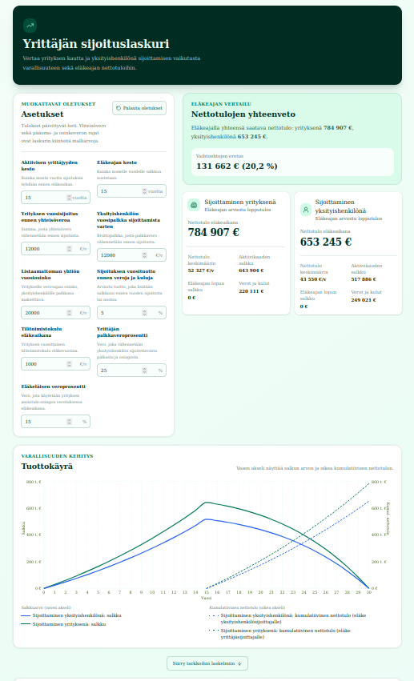

# Yrittäjän sijoituslaskuri

Selainpohjainen laskuri vertailee yrityksen kautta ja yksityishenkilönä
sijoittamisen vaikutusta salkun kehitykseen sekä eläkeajan nettotuloihin Suomessa.

Laskenta noudattaa repositorion [`SPEC.md`](./SPEC.md)-tiedostoa. Käyttäjä voi
muuttaa sijoitusmääriä, kestoja, tuotto-odotusta, tilitoimistokulua sekä
yrittäjän palkka- ja eläkeläisen veroprosenttia. Yhteisövero sekä pääoma- ja
osinkoverotuksen rajat ja ehdot ovat laskurin kiinteitä malliarvoja.



Huom: Sovellusta on testattu jonkin verran, mutta lisää testausta vaaditaan.

## Käyttö

```bash
pnpm install
pnpm dev
```

Avaa sovellus osoitteessa [http://localhost:3000](http://localhost:3000).
Asetukset tallennetaan vain selaimen `localStorage`-tallennukseen avaimella
`yrittajan-sijoituslaskuri:asetukset:v1`.

## Tarkistukset

```bash
pnpm lint
pnpm typecheck
pnpm test
pnpm test:e2e
pnpm build
```

`pnpm test:e2e` tarvitsee Playwright Chromium -selaimen. Asenna se tarvittaessa:

```bash
pnpm exec playwright install chromium
```

